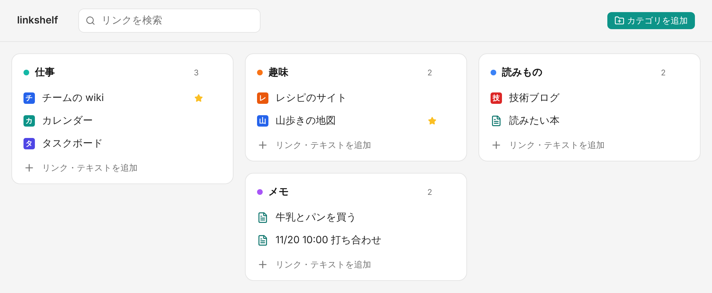
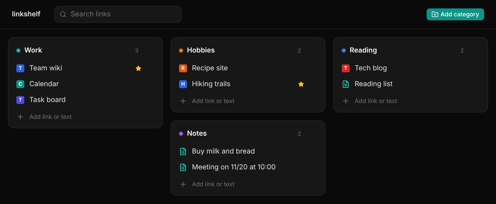

# linkshelf

[](https://www.npmjs.com/package/linkshelf)
[](https://github.com/shiodome47/linkshelf/actions/workflows/ci.yml)
[](https://github.com/shiodome47/linkshelf/blob/main/LICENSE)

リンク・1 行メモ・長めのテキストを、カードに分けて棚に並べる React の部品です。
A React component that organizes links, one-line notes and longer texts into cards on a shelf.

**デモ / Demo：https://linkshelf-chi.vercel.app**



```bash
npm install linkshelf
```

```tsx
import { LinkShelf } from 'linkshelf'
import 'linkshelf/style.css'

export function App() {
  return <LinkShelf />
}
```

[日本語](#日本語) ・ [English](#english)

---

## 日本語

### できること

- カードを作る・名前と色を変える・ドラッグで並べ替える（スマホでは 1 列）
- URL を入れて Enter でリンク、それ以外の 1 行は 1 行メモ（ダブルクリックで書き換え）
- 長めのテキスト（書く・.txt を置く）、検索、サイトのアイコン
- お気に入り（星）。検索の横の星のボタンで、お気に入りだけを表示
- ライト / ダーク表示、日本語 / 英語の表示

### こんな使い方も

リンク・1 行メモ・テキストを、カードに分けて自由に並べられるので、いろいろな用途に使えます。

- **ブックマーク集**：よく使うサイトを、仕事・趣味などのカードに分けて並べる
- **備忘録・覚書**：思いついたことを 1 行メモで書きとめる。長いものはテキストに
- **かんたんなカンバン**：「やること」「作業中」「終わった」のカードを作り、項目をドラッグで移していく（期限や担当者を付ける機能はありません）
- **調べものの整理**：テーマごとのカードに、参考にしたページとメモをまとめる
- **目標の管理**：目標ごとのカードに、やることと、役に立つリンクを並べる

データはブラウザの中（IndexedDB）に保存されます。見た目は `.linkshelf` の中だけに効くので、Tailwind が無いアプリでも、あるアプリでも使えます。`react` と `react-dom`（18 か 19）が必要です。

### 設定（props）

| 名前 | 意味 | 既定 |
|---|---|---|
| `storage` | 保存先（下の「保存先を変える」） | `indexedDbStorage()` |
| `fetchTitle` | ページの名前を取る関数 `(url) => Promise<string \| null>` | なし（名前は URL から作る） |
| `theme` | `'light'` / `'dark'` / `'system'`（端末の設定に合わせる） | `'system'` |
| `locale` | 画面の言葉。`'ja'`（日本語）/ `'en'`（英語） | `'ja'` |
| `title` | 見出し | `'リンク集'`（英語では `'Links'`） |
| `readOnly` | 閲覧専用（下の「閲覧専用にする」） | `false` |
| `actions` | 見出しの右に足すもの（テーマの切り替えボタンなど） | なし |
| `className` | いちばん外側に足す class | なし |

`storage` と `fetchTitle` は、最初に渡したものを使い続けます。

### 保存先を変える

```tsx
import { LinkShelf, indexedDbStorage, memoryStorage } from 'linkshelf'

// ブラウザの中に保存（名前を変えれば、1 つのサイトに 2 つ置ける）
<LinkShelf storage={indexedDbStorage({ name: 'my-links' })} />

// メモリだけ（ページを閉じると消える。テストや見本に）
<LinkShelf storage={memoryStorage()} />
```

自分の保存先（サーバーなど）を使うときは、`LinkShelfStorage` の形の物を渡します。

```ts
import type { LinkShelfStorage } from 'linkshelf'

const myStorage: LinkShelfStorage = {
  loadAll: async () => ({ categories: [], links: [] }),
  putCategory: async (category) => {},
  deleteCategory: async (id) => {},
  putLink: async (link) => {},
  deleteLinks: async (ids) => {},
  // bulkPut は無くてもよい（無ければ 1 件ずつ put する）
  // subscribe も無くてもよい（下の「ほかの端末の変更を出す」）
}
```

#### ほかの端末の変更を出す（同期するとき）

保存先に `subscribe` を付けると、中身が外から変わったとき（同期でほかの端末の変更が届いたときなど）に、画面を読み直します。

```ts
const syncedStorage: LinkShelfStorage = {
  ...myStorage,
  // 変わったら onChange を呼ぶ。戻り値は、知らせをやめる関数
  subscribe: (onChange) => mySync.onRemoteChange(onChange),
}
```

### 閲覧専用にする

`readOnly` を付けると、リンクを開く・検索・お気に入りだけ表示はできて、追加・編集・削除・並べ替え・星を付けることはできなくなります。サイトを見に来た人には閲覧専用、編集する人には編集できる画面、のように使い分けられます。

```tsx
<LinkShelf storage={siteStorage} readOnly={!isEditor} />
```

**注意**：`readOnly` は画面のボタンを隠すだけです。書き換えを本当に防ぐには、保存先（サーバー）の側でも「編集する人以外の書き込みを断る」ようにしてください。

### ページの名前を取る

ブラウザからは、ほかのサイトのページを直接読めません（CORS という制限）。名前を自動で付けたいときは、サーバー側で名前を取る処理を用意して、`fetchTitle` で渡します。

```tsx
<LinkShelf
  fetchTitle={async (url) => {
    const res = await fetch(`/api/title?url=${encodeURIComponent(url)}`)
    if (!res.ok) return null
    const data = await res.json()
    return typeof data.title === 'string' ? data.title : null
  }}
/>
```

サーバー側の処理の例は [`examples/web/api/title.ts`](https://github.com/shiodome47/linkshelf/blob/main/examples/web/api/title.ts) にあります（Vercel の関数）。内部ネットワークを覗かれないための対策が入っているので、使うときは削らないでください。

### 色を合わせる

色は CSS の変数で決まっています。上書きすると、アプリの色に合わせられます。

```css
.linkshelf {
  --ls-accent: #2563eb; /* 決定のボタン・ドラッグの線 */
}
```

| 変数 | 意味 |
|---|---|
| `--ls-bg` | 画面の背景 |
| `--ls-card` | カードの背景 |
| `--ls-border` | 枠線 |
| `--ls-text` | 文字 |
| `--ls-muted` | うすい文字 |
| `--ls-accent` | 決定のボタン・ドラッグの線 |
| `--ls-danger` | 削除 |

ライト表示だけ変えるときは `.linkshelf[data-theme='light'] { … }` に書きます。

### 安全のために

- `javascript:` などの危ない URL は、リンクにしません。保存先から読んだ URL も、開く前にもう一度確かめます。
- テキストは文字として表示するだけです（HTML として読み込みません）。
- サイトのアイコンは、そのサイト自身の `/favicon.ico` を読むだけです。外部のアイコンサービスは使いません。

### 見本のページ

[`examples/web`](https://github.com/shiodome47/linkshelf/tree/main/examples/web) に、この部品を使った単独のアプリがあります（[デモ](https://linkshelf-chi.vercel.app)）。データは、開いたブラウザの中だけに保存されます（ほかの端末やほかの人には見えません）。画面の言葉は、ブラウザの言葉に合わせて日本語か英語になります。

---

## English



### Features

- Create cards, rename and recolor them, drag to reorder (one column on phones)
- Type a URL and press Enter to add a link; any other single line becomes a note (double-click to edit)
- Longer texts (write one or drop a .txt), search, site icons
- Favorites (star), with a button next to search to show favorites only
- Light / dark theme, Japanese / English labels

### Ideas

Because you can mix links, one-line notes and texts freely across cards, linkshelf fits many uses:

- **Bookmarks**: group the sites you use often into cards such as Work and Hobbies
- **Notes and reminders**: jot things down as one-line notes; use texts for longer ones
- **A simple kanban board**: make “To do”, “Doing” and “Done” cards and drag items across (no due dates or assignees)
- **Research**: collect pages and notes for each topic in its own card
- **Goals**: list the steps and useful links for each goal

Data is saved in the browser (IndexedDB). Styles only apply inside `.linkshelf`, so it works with or without Tailwind in your app. Requires `react` and `react-dom` (18 or 19).

```tsx
<LinkShelf locale="en" />
```

### Props

| Name | Description | Default |
|---|---|---|
| `storage` | Where to save data (see below) | `indexedDbStorage()` |
| `fetchTitle` | `(url) => Promise<string \| null>` that returns a page title | none (titles come from the URL) |
| `theme` | `'light'` / `'dark'` / `'system'` | `'system'` |
| `locale` | Language of the labels: `'ja'` (Japanese) / `'en'` (English) | `'ja'` |
| `title` | Heading | `'リンク集'` (`'Links'` in English) |
| `readOnly` | View-only mode (see below) | `false` |
| `actions` | Extra elements on the right side of the header (e.g. a theme toggle) | none |
| `className` | Extra class on the root element | none |

`storage` and `fetchTitle` are read once, on first render.

### Storage

```tsx
import { LinkShelf, indexedDbStorage, memoryStorage } from 'linkshelf'

<LinkShelf storage={indexedDbStorage({ name: 'my-links' })} />
<LinkShelf storage={memoryStorage()} />
```

To use your own backend, pass an object that implements `LinkShelfStorage`
(`loadAll`, `putCategory`, `deleteCategory`, `putLink`, `deleteLinks`, and optionally `bulkPut`).
Add an optional `subscribe(onChange)` that returns an unsubscribe function, and the shelf reloads whenever your storage changes from outside (for example, when another device syncs).

### View-only mode

With `readOnly`, visitors can open links, search and show favorites only, but cannot add, edit, delete, reorder or star anything.

```tsx
<LinkShelf storage={siteStorage} readOnly={!isEditor} />
```

`readOnly` only hides the editing UI. To really prevent changes, your storage (server) must also reject writes from anyone but the editors.

### Page titles

Browsers cannot read other sites directly (CORS), so fetching titles needs a server. Pass a `fetchTitle` function that calls your endpoint.
[`examples/web/api/title.ts`](https://github.com/shiodome47/linkshelf/blob/main/examples/web/api/title.ts) is an example Vercel function with SSRF protections (address checks, redirect checks, size and time limits). Keep them if you reuse it.

### Theming

Override the CSS variables on `.linkshelf`: `--ls-bg`, `--ls-card`, `--ls-border`, `--ls-text`, `--ls-muted`, `--ls-accent`, `--ls-danger`.

### Security

- Unsafe URLs such as `javascript:` are never turned into links, and URLs are checked again before opening.
- Texts are rendered as plain text, never as HTML.
- Site icons are loaded from each site's own `/favicon.ico`; no third-party icon service is used.

## License

[MIT](https://github.com/shiodome47/linkshelf/blob/main/LICENSE)
